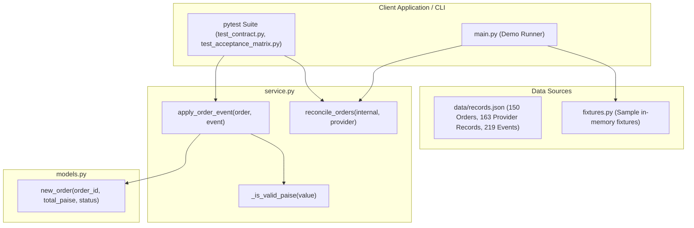
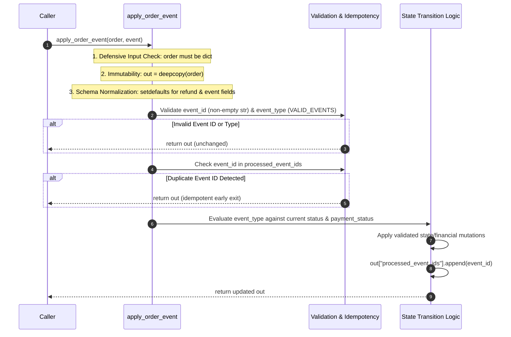
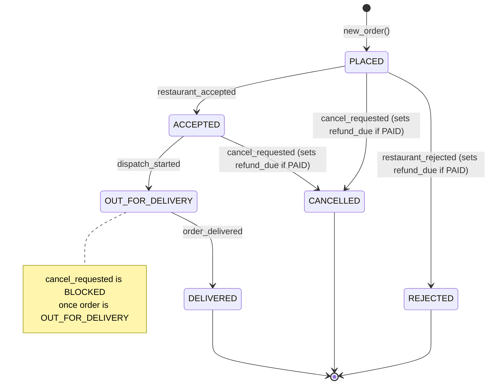
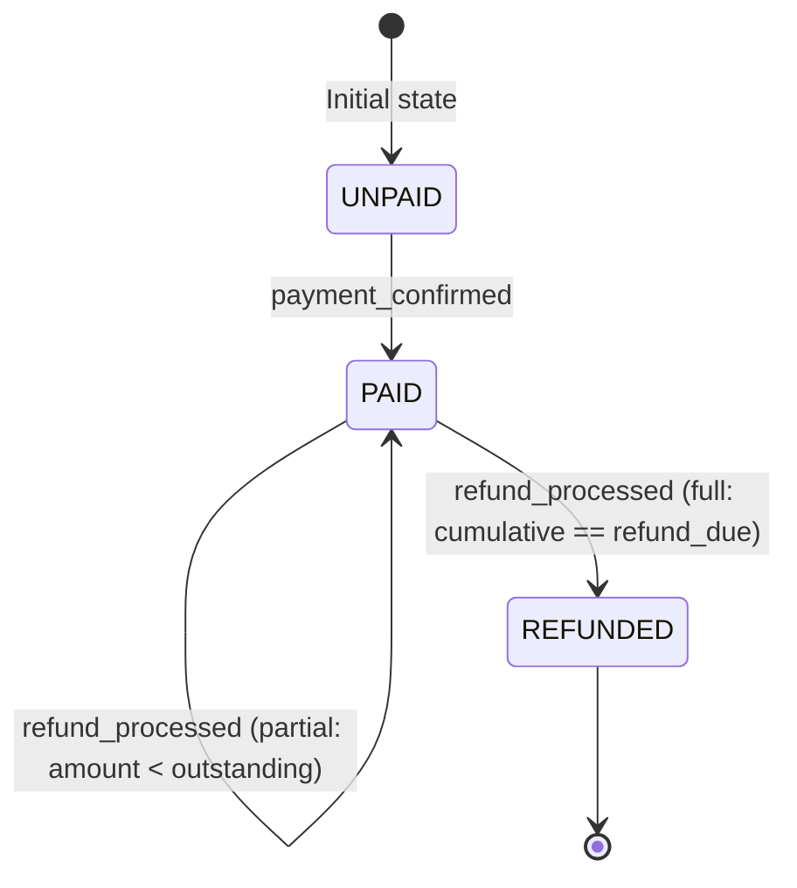
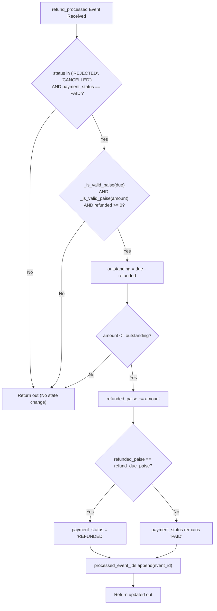
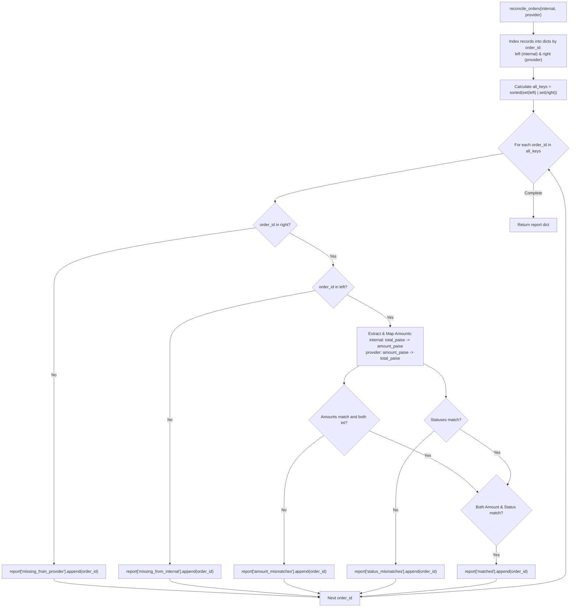

# OrderOps System Architecture & Technical Specification

> **System:** OrderOps (Order Failure, Cancellation & Refund Reconciliation)
> **Author:** Shubham Kumar
> **Repository:** `OrderOps-Open-Source-Evaluation`
> **Language & Platform:** Python 3.10+ (Standard Library only, `copy.deepcopy`)
> **Scope:** Core service lifecycle, idempotency engine, refund boundaries, and payment reconciliation.

---

## 1. System Overview

OrderOps is a specialized food-delivery order lifecycle and financial consistency engine. In modern food-delivery platforms (inspired by platforms like Zomato), order state transitions, kitchen operations, rider logistics, and payment flows are inherently distributed and asynchronous.

A customer can successfully pay before the restaurant accepts an order. A restaurant may subsequently reject the order due to item stockout; a customer may cancel before dispatch; and refund notifications from banking partners can arrive out of order, delayed, or duplicated.

OrderOps provides a deterministic, fail-safe state machine that:
1. Validates and enforces sequential order and payment state transitions.
2. Defends against duplicate event delivery using strict idempotency tracking.
3. Enforces financial refund rules in integer paise, preventing double-refunding or over-refunding.
4. Performs automated bidirectional reconciliation between internal transaction ledgers and third-party payment provider summaries.

---

## 2. Problem Domain and Scope

### Asynchronous Operations Challenges
- **Decoupled Financial & Operational Lifecycle:** Payment capture and restaurant acceptance do not occur in a single atomic transaction. An order can be `PLACED` and `PAID` simultaneously while awaiting kitchen confirmation.
- **At-Least-Once Delivery Semantics:** Upstream message queues (Kafka, SQS, Webhooks) deliver duplicate messages. Without idempotent handling, duplicate `payment_confirmed` or `refund_processed` events can cause severe financial leakage.
- **Dispatch Boundary & Customer Cancellation:** Cancellation is strictly forbidden once an order is marked `OUT_FOR_DELIVERY`. In-flight deliveries cannot be cancelled unilaterally without physical logistics coordination.
- **Reconciliation Inconsistencies:** Internal databases (schema: `total_paise`) and provider payment gateway settlements (schema: `amount_paise`) diverge due to network drops, timing windows, or partial captures.

### Explicit Scope
- **In Scope:** Event processing for 7 canonical events, order and payment status transitions, integer-based refund arithmetic, duplicate event deduplication, bidirectional reconciliation reporting.
- **Out of Scope:** Network transports, database persistence layers, multithreaded lock managers, real external payment gateway integrations.

---

## 3. High-Level Architecture

OrderOps is structured as a pure, side-effect-free domain service library. It operates entirely on in-memory representations (`dict` records) with deep copying to ensure state immutability.



---

## 4. Component & Module Responsibilities

| Module | Primary Function / Object | Architectural Responsibility |
|---|---|---|
| `service.py` | `apply_order_event(order: dict, event: dict) -> dict` | Central state machine. Consumes current order state and an event payload, performs strict validation, idempotency filtering, transition logic, and returns a new updated order copy. |
| `service.py` | `_is_valid_paise(value: Any) -> bool` | Precision type guard. Accepts only strict positive integers (`type(v) is int and v > 0`), explicitly rejecting booleans, floats, strings, nulls, and negative numbers. |
| `service.py` | `reconcile_orders(internal: list[dict], provider: list[dict]) -> dict` | Bidirectional ledger reconciliation engine. Compares internal records against provider records by `order_id`, mapping field differences, and generates sorted, deterministic discrepancy buckets. |
| `models.py` | `new_order(order_id, total_paise, status="PLACED") -> dict` | Domain factory function. Initialises an order record with default schema keys: `payment_status="UNPAID"`, `refund_due_paise=0`, `refunded_paise=0`, `processed_event_ids=[]`. |
| `fixtures.py` | `sample_orders()`, `sample_provider_orders()` | Synthetic test fixtures used for local execution, demos, and baseline verification. |
| `main.py` | `__main__` entrypoint | Offline demo harness executing `reconcile_orders` over `sample_orders` and printing categorized discrepancy lists. |

---

## 5. Data Model and Important Fields

Order records in OrderOps are schema-governed dictionaries containing 7 core attributes:

| Field Name | Type | Permitted Values | Architectural Role |
|---|---|---|---|
| `order_id` | `str` | Non-empty string (e.g. `"ORD-1001"`) | Primary business identifier used for tracking and ledger reconciliation. |
| `total_paise` | `int` | Integer > 0 | Total payable order value expressed in integer paise (₹1.00 = 100 paise). |
| `status` | `str` | `PLACED`, `ACCEPTED`, `REJECTED`, `CANCELLED`, `OUT_FOR_DELIVERY`, `DELIVERED` | Operational status of the order in the restaurant/delivery workflow. |
| `payment_status` | `str` | `UNPAID`, `PAID`, `REFUNDED` | Financial settlement state of the customer transaction. |
| `refund_due_paise` | `int` | Integer >= 0 | Total refundable liability established when a paid order is cancelled or rejected. |
| `refunded_paise` | `int` | Integer >= 0 | Cumulative refund amount successfully processed so far. |
| `processed_event_ids` | `list[str]`| List of string event IDs | Append-only audit log of unique event IDs processed by this order instance. |

---

## 6. Event-Processing Flow

When `apply_order_event(order, event)` is called, the processing pipeline executes through 5 strictly ordered phases:



---

## 7. Order State Lifecycle

The order state machine strictly enforces valid transitions across 6 operational states. Any transition outside the defined paths is rejected as a silent no-op, preserving the existing state.



### Transition Enforcement Rules
1. `restaurant_accepted`: Only valid when `status == "PLACED"`. Changes status to `ACCEPTED`.
2. `restaurant_rejected`: Only valid when `status == "PLACED"`. Changes status to `REJECTED`. If `payment_status == "PAID"`, sets `refund_due_paise = total_paise`.
3. `cancel_requested`: Only valid when `status in ("PLACED", "ACCEPTED")`. Changes status to `CANCELLED`. If `payment_status == "PAID"`, sets `refund_due_paise = total_paise`. If order is `OUT_FOR_DELIVERY` or `DELIVERED`, the cancellation is completely ignored.
4. `dispatch_started`: Only valid when `status == "ACCEPTED"`. Changes status to `OUT_FOR_DELIVERY`.
5. `order_delivered`: Only valid when `status == "OUT_FOR_DELIVERY"`. Changes status to `DELIVERED`.

---

## 8. Payment and Refund Lifecycle

Financial states operate orthogonal to the delivery status, with synchronization points on cancellations, rejections, and refund events:



### Refund Processing Flowchart



---

## 9. Idempotency Mechanism

Distributed queue retries and client retries require absolute idempotency. OrderOps implements idempotency via an append-only audit trail:

1. **Storage:** The order tracks `processed_event_ids` as a list of strings.
2. **Pre-execution Gate:** Prior to parsing the event payload, line 57 of `service.py` executes:
   ```python
   if event_id in processed_ids:
       return out
   ```
3. **Immutability Guarantee:** If `event_id` is present, the function returns immediately without evaluating transition conditions, mutating amounts, or re-appending the ID.
4. **Different Payload with Same ID:** If an event arrives with an existing `event_id` but conflicting payload (e.g. First: `payment_confirmed`, Second: `restaurant_accepted`), the second event is completely dropped, preserving the original state.
5. **Event Recording Scope:** Only valid events that successfully pass the validation and idempotency gates have their `event_id` appended to `processed_event_ids`.

---

## 10. Reconciliation Workflow

The reconciliation engine `reconcile_orders(internal, provider)` identifies discrepancies between internal orders and external provider summaries.



### Determinism & Categorization Rules
- **Schema Mapping:** Internal orders use `total_paise` (fallback `amount_paise`). Provider records use `amount_paise` (fallback `total_paise`).
- **Independent Categorization:** An order with both an amount mismatch and a status mismatch (e.g., `ORD-1078`) is placed in **both** `amount_mismatches` and `status_mismatches`. It is excluded from `matched`.
- **Deterministic Ordering:** All iteration is driven by `sorted(set(left) | set(right))`, ensuring that output lists are always alphabetically sorted and reproducible across platforms.

---

## 11. Error & Malformed-Input Handling

OrderOps employs defensive programming patterns to guarantee zero uncaught runtime exceptions:

| Malformed Input Condition | Handler in Code | Resulting Behaviour |
|---|---|---|
| `order` is not a `dict` (e.g., `None`, `list`, `int`) | `if not isinstance(order, dict): return order` | Returns input unmutated. |
| `event` is not a `dict` | `if not isinstance(event, dict): return out` | Returns deep-copied order without modification. |
| `event_id` is missing, `None`, empty string, or whitespace | `if not isinstance(event_id, str) or not event_id.strip(): return out` | Ignored, no transition, not added to processed IDs. |
| `event_type` is unhashable (list/dict) or unknown string | `if not isinstance(event_type, str) or event_type not in VALID_EVENTS: return out` | Safely deflected without `TypeError: unhashable type`. |
| `amount_paise` is boolean `True`/`False` | `type(value) is int and value > 0` | Strict type equality rejects boolean (since `type(True) is bool`). |
| `amount_paise` is float (e.g., `1.5`) or string (e.g., `'100'`) | `_is_valid_paise(amount)` returns `False` | Rejected before arithmetic. |
| Reconciliation input `internal` or `provider` is not a `list` | `if not isinstance(internal, list): internal = []` | Normalized to empty list; returns empty discrepancy report. |
| Non-dict or missing `order_id` in reconciliation list | Filtered in dict comprehension `isinstance(row, dict) and ...` | Malformed row skipped silently. |

---

## 12. Design Decisions and Trade-offs

1. **Integer Paise vs Floating Point Currency:**
   - *Decision:* Represent all money exclusively in integer paise (₹1 = 100 paise).
   - *Trade-off:* Requires conversion at UI boundaries, but completely eliminates IEEE 754 floating-point rounding errors (e.g., `0.1 + 0.2 != 0.3`).
2. **Deep Copy vs In-Place Mutation:**
   - *Decision:* `out = deepcopy(order)` at the start of event processing.
   - *Trade-off:* Small memory/CPU overhead per event, but guarantees caller immutability and makes functions pure and side-effect free.
3. **List-based Event ID Tracking:**
   - *Decision:* Store `processed_event_ids` as a JSON-serializable list rather than an in-memory `set`.
   - *Trade-off:* $O(N)$ lookup per event check. Acceptable because an individual food order typically processes fewer than 10 events over its lifetime.
4. **Schema Asymmetry in Reconciliation:**
   - *Decision:* Dynamically inspect `total_paise` and fallback to `amount_paise`.
   - *Trade-off:* Slightly more verbose extraction logic, but seamlessly bridges disparate internal vs provider data models without requiring an external translation layer.

---

## 13. Evidence Sources

- `STUDENT_PROBLEM_STATEMENT.md` (Contract requirements 1–7)
- `service.py` (Source implementation lines 1–219)
- `models.py` (Schema factory lines 1–7)
- `data/records.json` (Dataset schema and anomaly distribution)
- `tests/test_contract.py` & `tests/test_acceptance_matrix.py` (Verification contract)
