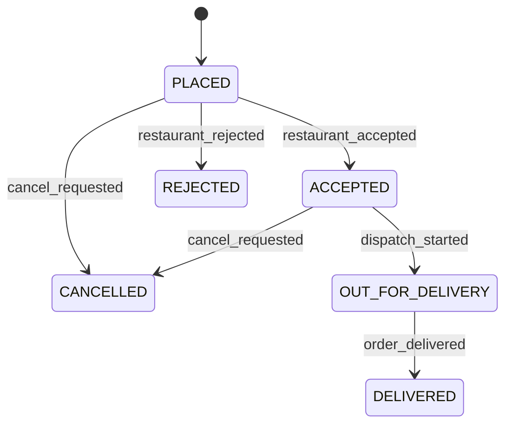

# OrderOps: explanation, requirements, plan, and working reference

> AI-assisted reference. Evaluator approval for AI assistance has not been granted, as clarified by the student on 30 October 2026. Codex contributions are documented in AI_ASSISTANCE.md.

## What the problem is asking

Build a small, offline Python service that keeps food-delivery order state and money
correct when notifications arrive more than once, in an unexpected sequence, or with
bad data. This is a repair of the supplied service, rather than a request for a
restaurant website or real payment integration.

Imagine an order worth 1,000 paise (Rs 10). Payment succeeds, then the customer cancels
before dispatch. The service owes 1,000 paise. A refund notification for 400 paise means
600 paise is still outstanding. Repeating that notification must not refund another
400 paise. Only a separate valid notification for the remaining 600 paise completes
the refund.

There are two independent questions:

- **Order state:** what happened to the food order?
- **Payment state:** was money paid, and has the full refund been processed?

A cancelled order remains `CANCELLED` after its payment becomes `REFUNDED`.

## The requirements in plain language

| Requirement | What the implementation must do |
|---|---|
| Seven supported events | Handle payment, acceptance, rejection, cancellation, dispatch, delivery, and refund notifications. |
| Valid transitions | Accept/reject only a placed order; cancel only before dispatch; deliver only an order already out for delivery. |
| Idempotency | Apply each `event_id` at most once per order. A repeated ID with a different payload also has no second effect. |
| Integer money | Use whole paise. Reject strings, floats, booleans, zero refunds, negative refunds, and refunds above the remaining due amount. |
| Refund eligibility | Refund only a paid order in `CANCELLED` or `REJECTED` state. |
| Partial refunds | Keep the original amount owed and the cumulative amount returned in separate fields. |
| Reconciliation | Compare both sources by order ID and distinguish missing records, amount differences, and status differences. Sort each output list. |
| Bad input | Preserve state on malformed or misaddressed events; explicitly reject ambiguous reconciliation input. |
| Evidence | Preserve the original tests, add regressions, document edge cases and an example flow. |

The repository has newer instructions than the attached two-page PDF. Its current
Markdown statement adds `approach.md`, `challenges.md`, and `optimizations.md` as
mandatory documentation worth 15 marks in total, and changes the rubric allocation.
The repository checklist identifies the Markdown statement as the source of truth
when it differs from the PDF. The published documents contain a general restriction
on AI assistance. On 30 October 2026, the student clarified that evaluator approval
for AI assistance has not been granted. This corrects the earlier permission claim.
The branch remains an AI-assisted reference with its contributions disclosed.

## Order flow



Payment confirmation does not move the order through this diagram. It changes
`payment_status`. There is no cancellation arrow from `OUT_FOR_DELIVERY` or `DELIVERED`.
A rejection after acceptance also leaves the state unchanged, matching the supplied
acceptance tests.

## The money model

| Field | Meaning | After a 400-paise refund against a 1,000-paise obligation |
|---|---|---|
| `total_paise` | Original order value | 1000 |
| `refund_due_paise` | Total refund obligation, not the remaining balance | 1000 |
| `refunded_paise` | Cumulative amount actually processed | 400 |
| Remaining refundable amount | `refund_due_paise - refunded_paise` | 600 |
| `payment_status` | `UNPAID`, `PAID`, or `REFUNDED` | `PAID` |

The amount check is `0 < amount_paise <= remaining`. Completion requires equality
between refunded and due amounts after an eligible positive refund. In Python,
`isinstance(True, int)` is true, so the validation deliberately uses
`type(amount) is int` to exclude booleans.

## Repository map

| File | Responsibility |
|---|---|
| `models.py` | Makes a new order dictionary. |
| `service.py` | Applies one event to one order; reconciles two collections of summaries. |
| `fixtures.py` | Small synthetic examples for the demo. |
| `main.py` | Runs the offline reconciliation demo. |
| `data/records.json` | Expanded synthetic data: 150 orders, 163 provider rows, 219 event examples. |
| `tests/test_contract.py`, `tests/test_acceptance_matrix.py` | The 212 original test cases, preserved unchanged. |
| `tests/test_regressions.py` | The 96 added reference regression cases. |
| `TESTING.md` | Actual commands, results, edge cases, and testing limits. |
| `ORDER_FLOW_NOTES.md` | An observed payment/cancellation/refund sequence. |

## Implementation plan and completed work

1. **Establish the baseline.** Read the source, dataset schema, tests, and CI. Run the
   unchanged demo and tests. Observed: **62 failed, 150 passed**.
2. **Protect the event boundary.** Validate the order snapshot, event ID/type, and
   optional target order ID. Return an independent copy. Ignore duplicate IDs before
   changing state or money.
3. **Make the transitions explicit.** Use a small transition table for the five
   lifecycle events. Keep payment and refunds as separate branches.
4. **Protect the refund ledger.** Check eligibility and strict integer amounts against
   the remaining obligation. Keep partial payments as `PAID`; complete only on the
   exact full amount. A late payment after an unpaid cancellation/rejection creates
   the refund obligation. A payment notification cannot reopen `REFUNDED`.
5. **Fix reconciliation.** Normalize `total_paise` and `amount_paise`, compare amount
   and status independently, and sort IDs. Reject malformed or conflicting summaries
   with a clear `ValueError`.
6. **Verify and explain.** Run the original tests, add regressions, exercise the larger
   dataset and original demo, and record the results. Observed: **308 passed**.

Only `service.py` changes production behavior. The models, fixtures, main module,
original tests, synthetic data, and GitHub Actions workflows remain unchanged.
No optional stretch feature was added.

## Root causes and fixes

| Observed defect | Root cause | Correction |
|---|---|---|
| Replaying a payment appended the same event ID twice; a refund could also repeat | IDs were recorded without a prior membership check | Return before processing an ID already in the order's history. |
| Invalid, excessive, or ineligible refunds changed the ledger or raised incidental type errors | Refund amounts were added without validating eligibility, type, or remaining balance | Validate all conditions before updating the cumulative refund amount. |
| Reconciliation called different statuses matched | It compared only amounts | Compare status separately; match only when both dimensions agree. |
| Both amount and status differed but only one discrepancy was visible | The comparison was an exclusive branch | Add the ID independently to each applicable discrepancy list. |
| The demo reported false amount mismatches | Internal rows have `total_paise`; provider rows have `amount_paise` | Normalize both documented schemas before comparison. |
| A new payment notification could reopen a fully refunded payment | Payment confirmation assigned `PAID` unconditionally | Change only `UNPAID` to `PAID`. |
| Unpaid cancellation followed by delayed payment left no refund due | The obligation was created only during cancellation/rejection | Establish the obligation when payment arrives for a terminal refundable order. |
| Conflicting duplicate summaries depended on input order | A dictionary comprehension silently kept the last row | Collapse identical summaries; raise on conflicting duplicates. |

## Important behavior choices

The brief does not specify every malformed-input or delayed-event policy. This
reference makes the choices explicit:

- Missing or unknown event types, invalid IDs, a different supplied order ID, or an
  unsafe order snapshot produce an unchanged independent copy. A non-dictionary
  order argument raises `TypeError`.
- A known, addressed event with a valid ID is consumed once even if its transition
  or refund is disallowed. Replaying a premature refund later cannot make it take
  effect. A corrected notification needs a new ID and valid conditions.
- Events may omit `order_id` in the single-order API, as the original tests do.
  If supplied, it must match. A caller processing a stream must route events to
  existing orders and handle unknown IDs without creating orders implicitly.
- Reconciliation accepts non-negative integer totals/amounts and non-empty string
  IDs/statuses. Missing or invalid fields and conflicting duplicate IDs raise
  `ValueError`, with no input mutation or partial report. Identical summaries collapse.
- Comparison concerns the order `status` and order value. Provider references and
  `payment_status` are metadata and are not additional comparison dimensions.

These are documented implementation decisions, not claims that unspecified
business policies have been decided by the evaluator.

## Run the solution

From the extracted `orderops-reference` directory, with Python 3.10 or newer:

```bash
python3 -m venv .venv
source .venv/bin/activate
python -m pip install -r requirements-dev.txt
python -m pytest -q
python -m main
```

Desktop verification used Python **3.14.7** and pytest **9.2.0**. The earlier separate reference was also tested with Python 3.12.14.

Expected demo output after the fixes:

```text
matched: ['ORD-101']
missing_from_provider: ['ORD-103']
missing_from_internal: ['ORD-104']
amount_mismatches: []
status_mismatches: ['ORD-102']
```

Try the event function in a Python shell:

```python
from models import new_order
from service import apply_order_event

order = new_order("EXAMPLE", 1000)
order = apply_order_event(order, {"event_id": "p1", "type": "payment_confirmed"})
order = apply_order_event(order, {"event_id": "c1", "type": "cancel_requested"})
order = apply_order_event(order, {
    "event_id": "r1", "type": "refund_processed", "amount_paise": 400
})
print(order["payment_status"], order["refund_due_paise"], order["refunded_paise"])
# PAID 1000 400
```

## Validation and limitations

All 212 original tests and 96 added cases passed locally. The dataset reconciliation
found 107 matched IDs, 12 missing from the provider, 25 missing internally, 20 amount
mismatches, and 12 status mismatches. Mismatch categories can overlap, so their counts
are not a disjoint partition. The dataset event regression routes events with known
order IDs and checks immediate replay safety and money bounds; it does not assert
that every event in the anomaly catalog should be accepted.

This remains an in-memory, offline exercise. It has no database, durable idempotency
ledger, concurrent-write protection, real payment-provider API, refund initiation,
or production audit log. Existing semantically inconsistent snapshots are not a
complete migration/repair problem solved by this patch. Python 3.14.7 was executed in the Desktop clone and Python 3.12.14 in the earlier
reference. Python 3.10/3.11 were not executed locally. See the draft PR for current
remote CI status; local results alone do not establish a remote CI result.

## Practice questions

1. Why does a partial refund keep `payment_status` as `PAID`?
2. If 400 of 1,000 paise has been refunded, why must a new 700-paise refund be rejected?
3. Why is `refund_due_paise` still 1,000 after the first partial refund?
4. What happens when a duplicate ID arrives with a different amount?
5. Which two discrepancy lists contain an ID when both amount and status differ?

Answers: 1. The full obligation is not complete. 2. Only 600 remains. 3. It records the
total obligation. 4. It has no second effect. 5. Both `amount_mismatches` and
`status_mismatches`.

## Sources and provenance

- Supplied `OrderOps Problem Statement.pdf`, read and visually inspected in this session.
- [Official repository](https://github.com/sunitazenith07-lang/OrderOps-Open-Source-Evaluation),
  read on 30 October 2026 at commit `e006d241e3d8ddf6520021a6ab554306a31a200b`.
- Desktop baseline/final pytest logs and XML, walkthrough JSON, and dataset report in
  `evidence/`. See `STEP_BY_STEP.md` for a beginner walkthrough of every implementation block. These are local results; they do not establish a remote CI result.
