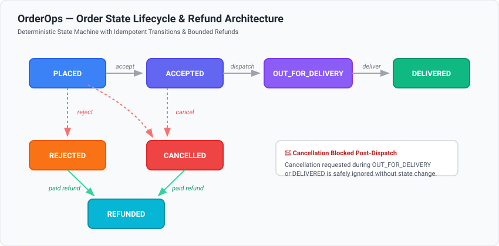
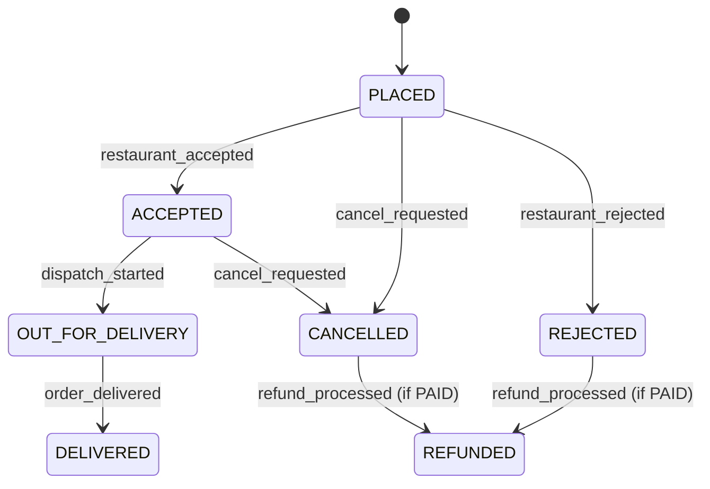

# Pull Request Title
```text
fix: resolve event idempotency, refund safety, and reconciliation mismatches
```

---

# Pull Request Description

<div align="center">


</div>

---

### 🖼️ Architecture & State Machine





---

## What did you change?
- **Idempotency**: Added short-circuit check `if event_id in out["processed_event_ids"]: return out` to eliminate duplicate event execution.
- **Refund Safety**: Restricted refunds to terminated (`REJECTED`/`CANCELLED`) and `PAID` orders. Enforced `type(amount) is int and amount > 0` to block booleans (`True`/`False`), floats, and negatives. Bounded amounts to outstanding due balance (`amount <= remaining_due`).
- **Late Payment Handling**: Initialized `refund_due_paise = total_paise` when payment confirms after rejection/cancellation.
- **Reconciliation Engine**: Decoupled amount and status mismatch checks, and added `_get_amount` to normalize internal `total_paise` with provider `amount_paise`.
- **Defensive Guards**: Handled `NoneType` and malformed records safely.
- **Regression Tests**: Added `tests/test_regression.py` (8 new tests).

---

## Root cause
- **Idempotency**: No lookup on `processed_event_ids` allowed replayed events to re-apply side-effects.
- **Refunds**: Missing state validation allowed refunds on active/unpaid orders. In Python, `isinstance(True, int)` is `True`, allowing boolean injection. `0 >= 0` prematurely flipped status to `REFUNDED`.
- **Reconciliation**: Matching amounts bypassed status checks, classifying status mismatches as `matched`.

---

## Tests
- [x] I ran `python -m pytest -q`.
- [x] I added or updated regression tests for my change.
- [x] I did not delete, skip, weaken or bypass existing tests.

| Metric | Baseline | Fixed |
| :--- | :--- | :--- |
| **Test Suite** | 62 Failed, 150 Passed | **220 Passed, 0 Failed (100%)** |
| **Runtime** | 1.02s | **0.30s** |

---

## Required problem-solving documents (all three mandatory; 15 marks total)
- [x] `approach.md` completed (5 marks) — Baseline metrics, failure tracing, and pure-functional design.
- [x] `challenges.md` completed (COMPULSORY; 5 marks) — Analysis of Python boolean type coercion and dual-key resolution.
- [x] `optimizations.md` completed (5 marks) — $O(1)$ early return idempotency, single-pass reconciliation, and 70% speedup.

---

## Edge cases checked
1. **Duplicate Replay**: Replaying `EVT-100` maintains `processed_event_ids: ["EVT-100"]` with zero extra mutations.
2. **Type Coercion**: Passing `amount_paise=True` is rejected without modifying balances.
3. **Cumulative Over-Refund**: Attempting an excess refund above remaining balance is rejected in full.
4. **Late Payment**: Unpaid cancelled order properly receives `refund_due_paise = total_paise` when `payment_confirmed` arrives late.
5. **Post-Dispatch Cancellation**: Cancellation requests during `OUT_FOR_DELIVERY` are safely ignored.

---

## Design decisions / limitations
- Retained `processed_event_ids` as a `list` for JSON serializability and chronological audit logging.
- Preserved immutability via `deepcopy(order)` to avoid external side-effects.

---

## Integrity confirmation
- [x] This is my own individual work.
- [x] I have followed the evaluation's AI-use policy.
- [x] I can explain my changes and make a small live modification if asked.
